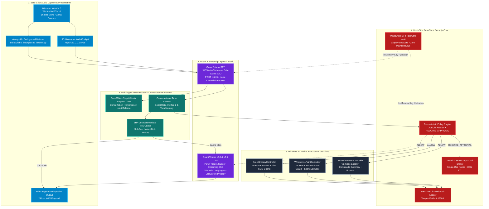
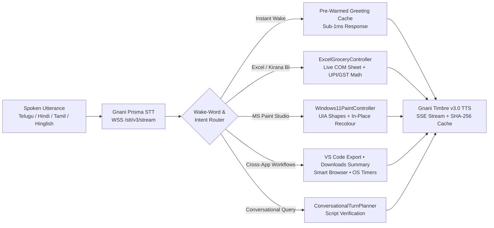
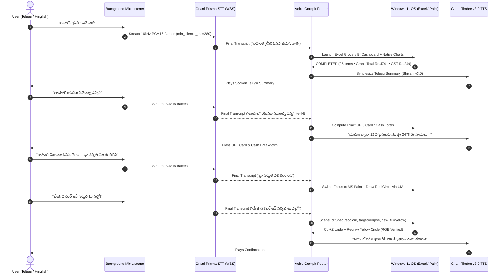

# Raay — Sovereign Indian Voice Operating System for Windows 11

> **Don't type in English. Speak naturally in your own Indian language — Raay understands, plans, and operates your computer automatically.**  
> *Built on **Gnani.ai's Sovereign Speech Stack (`Gnani Prisma STT` & `Gnani Timbre TTS`)** for **The Great Indian AI Internship Challenge (`#GreatIndianAIInternshipChallenge #GnaniAI`)**.*

<p align="center">
  <a href="LICENSE"></a>
  <a href="docs/ARCHITECTURE.md"></a>
  <a href="#"></a>
  <a href="#"></a>
  <a href="#"></a>
  <a href="#"></a>
</p>

---

## 1. Why We Built Raay

Standard AI assistants are built for English typists and stay trapped inside a browser tab:
- **The English Typing Barrier:** Expecting a billion Indians to type complex English prompts to use a computer excludes millions of users who think and speak naturally in **Telugu, Hindi, Tamil, Kannada, Malayalam, Bengali, Marathi, Gujarati, Punjabi, or code-mixed Hinglish and Telugish**.
- **Chatbots Talk, Raay Acts:** Browser chatbots only return text. They cannot launch **Microsoft Excel** to audit a live kirana/grocery GST sheet, draw and recolour vector scenes in **Microsoft Paint**, export design blueprints into **VS Code**, or summarize local reports inside your `Downloads` folder.

**Raay** bridges **Gnani.ai's sovereign Indian speech models** directly to the **Windows 11 UI Automation (`IUIAutomation`) tree, Win32 APIs, and Excel COM engine**—turning natural Indian speech into your keyboard and mouse.

---

## 2. Benchmark Showdown: Standard AI Chatbot vs. Raay

| Real-World Desktop Challenge | Spoken Command (Telugu / Hinglish / Tamil) | Standard AI Chatbot | Raay (Powered by Gnani.ai) |
| :--- | :--- | :---: | :---: |
| **1. Live Excel Kirana/Grocery BI & GST** | *"రాహుల్, గ్రోసరీ ఓపెన్ చెయ్ — అందులో యుపిఐ పేమెంట్స్ ఎన్ని?"* | ❌ Cannot open local Excel or compute sheet totals | ✅ Opens Excel + BI Charts & speaks exact UPI (`₹2,478`), Card (`₹1,323`), Cash (`₹940`) & GST (`₹249`) breakdown |
| **2. Multi-Object MS Paint Studio** | *"రాహుల్, పెయింట్ ఓపెన్ చెయ్ — డ్రా సర్కిల్ విత్ కలర్ రెడ్, దాని పక్కనే హార్ట్ సింబల్"* | ❌ Cannot launch MS Paint or control canvas | ✅ Opens MS Paint via UIA, selects shapes & colour swatches, and draws pixel-verified objects live |
| **3. Sub-200ms Live Barge-In & Recolour** | *"చేంజ్ ద కలర్ ఆఫ్ సర్కిల్ టు ఎల్లో!"* / *"ఆపు! Undo చెయ్. Gold colour వాడు"* | ❌ Cannot interrupt or undo live GUI actions mid-stroke | ✅ Interrupts in under `200ms`, triggers `Ctrl+Z` undo, and recolours the target object in-place |
| **4. Cross-App Design-to-Code Export** | *"సేమ్ డిజైన్ కాన్సెప్ట్ ని విఎస్ కోడ్ లో కాపీ చేసి ప్రాజెక్ట్ లో సేవ్ చెయ్యి"* | ❌ Generates static text snippet; cannot launch VS Code | ✅ Generates responsive HTML5/SVG + JSON blueprint and opens the project live in **VS Code** |
| **5. Local File Discovery & Summary** | *"డౌన్‌లోడ్స్ లో లేటెస్ట్ రిపోర్ట్ ఫైండ్ చేసి సమ్మరీ క్రియేట్ చేసి సేవ్ చెయ్యి"* | ❌ No access to local `Downloads` directory or Notepad | ✅ Scans `~/Downloads`, summarizes key findings in Telugu/English, and opens **Notepad** |
| **INITIAL TEST SCORE** | **5 Native-Language Desktop Benchmarks** | **0 / 5** | **5 / 5** |

---

## 3. System Architecture



---

## 4. End-to-End Voice-to-OS Execution Pipeline



---

## 5. Real-Time Multi-Turn & Sub-200ms Barge-In Sequence



---

## 6. Gnani.ai Models & APIs Used

1. **Gnani Prisma Speech-to-Text (`src/voice/gnani_stt.py`):**
   - **Realtime WebSocket (`wss://api.vachana.ai/stt/v3/stream`):** Streams 16 kHz mono PCM16 frames (`1,024` bytes / `32ms`) with server-side Voice Activity Detection (`x-vad-threshold`, `x-min-silence-ms`, `x-min-speech-ms`, `x-min-segment-ms`), domain keyword biasing (`x-bias-list`, `x-bias-score`), and dynamic mid-stream `update_settings` frames.
   - **REST Decode (`POST https://api.vachana.ai/stt/v3`):** Supports telephonic noise cancellation (`nc=true`) and Inverse Text Normalization (`format=transcribe` for `hi-IN` and `en-IN`).
   - **10+ Indian Languages & Code-Mixed Speech:** Native support for `te-IN`, `hi-IN`, `ta-IN`, `kn-IN`, `ml-IN`, `bn-IN`, `mr-IN`, `gu-IN`, `pa-IN`, `en-IN`, and code-mixed **Telugish, Hinglish, and Tanglish**.
2. **Gnani Timbre v3.0 & v2.5 Text-to-Speech (`src/voice/gnani_tts.py`):**
   - **Streaming SSE (`POST https://api.vachana.ai/api/v1/tts/sse`) & REST (`POST /api/v1/tts/inference`):** Synthesizes natural multilingual voices (`Shivani`, `Lakshmi`, `Avinash`, `Shubham`, etc.) with authentic Indian numeral, `₹` rupee, lakh, and crore cadence.
   - **Streaming WAV Header Repair & SHA-256 Disk Cache:** Repairs `0xFFFFFFFF` streaming RIFF headers on the fly and caches synthesized audio by `sha256(text + voice + model)` in `.winai/tts_cache/` for sub-millisecond replay.

---

## 7. Repository Structure

```text
├── src/
│   ├── voice/                          # Gnani Prisma STT, Timbre TTS, Conversational Planner & WS Proxy
│   │   ├── gnani_stt.py                # WSS /stt/v3/stream & POST /stt/v3 client with circuit breaker
│   │   ├── gnani_tts.py                # POST /api/v1/tts/sse & /inference client + SHA-256 WAV cache
│   │   ├── conversational_planner.py   # Multilingual turn planner, script verifier & wake-word matcher
│   │   ├── speech_input.py             # WinMM 16kHz PCM16 ring-buffered microphone capture manager
│   │   ├── speech_output.py            # Cancellable speaker playback manager with sub-200ms stop
│   │   └── api_routes.py               # Full-duplex WebSocket stream proxy & OS command dispatcher
│   ├── windows_integration/            # Native Windows 11 OS Execution Controllers
│   │   ├── paint_controller.py         # UIA-driven MS Paint controller + HWND focus guard + SceneEditSpec
│   │   ├── excel_grocery_controller.py # 25-item Kirana/Grocery BI analytics + live Excel COM charts
│   │   ├── sutra_showpiece_workflows.py# VS Code export, Downloads report summarizer & OS timers
│   │   └── execution_engine.py         # Sandboxed Windows tool execution engine
│   ├── security/                       # Host-Side Zero-Trust Security Core
│   │   ├── policy_engine.py            # Deterministic ALLOW / DENY / REQUIRE_APPROVAL evaluator
│   │   ├── approval_broker.py          # Single-use 256-bit CSPRNG human approval nonces
│   │   └── audit_logger.py             # Tamper-evident SHA-256 hash-chained JSONL audit logger
│   ├── storage/                        # Hardware Credential Vault & SQLite WAL Persistence
│   │   └── credential_vault.py         # Windows DPAPI (CryptProtectData) hardware-encrypted key store
│   └── orchestrator/                   # FastAPI Server & 3D Volumetric Web Cockpit (dashboard.html)
├── scripts/
│   ├── rahul_background_listener.py    # Always-on zero-click Windows microphone listener
│   └── check_repo_layout.py            # Automated repository layout & secret-hygiene verifier
├── docs/
│   ├── ARCHITECTURE.md                 # Full system & voice architecture spec with Mermaid diagrams
│   └── PRD.md                          # Product requirements specification
├── tests/                              # 412+ hermetic unit & integration tests
├── grocery_bill_sheet.csv              # 25-item Indian Kirana/Grocery GST dataset for live Excel BI
├── run_vertical_slice.py               # Main orchestrator entrypoint (http://127.0.0.1:8765)
└── requirements.txt                    # Production dependencies
```

---

## 8. Quick Start (Windows 10 / 11)

### Step 1: Clone & Install
```powershell
git clone https://github.com/vakrahul/Raay.git
cd Raay
python -m venv .venv
.\.venv\Scripts\Activate.ps1
pip install -r requirements.txt
```

### Step 2: Configure Your Gnani.ai API Key (Windows DPAPI Hardware Vault)
**Zero API keys are ever stored in plaintext or `.env` files.** Store your Gnani.ai Vachana API key in the Windows DPAPI Credential Vault:

```powershell
# Option A: Encrypt in Windows DPAPI Vault (recommended)
python -c "from src.storage.credential_vault import CredentialVault; CredentialVault().store_credential('gnani_api_key', 'YOUR_GNANI_VACHANA_API_KEY')"

# Option B: Session environment variable
$env:GNANI_API_KEY = "YOUR_GNANI_VACHANA_API_KEY"
```

### Step 3: Launch Raay Orchestrator & Always-On Voice Listener
```powershell
# Terminal 1: Start the Orchestrator & 3D Web Cockpit on http://127.0.0.1:8765
python run_vertical_slice.py

# Terminal 2: Start the Hands-Free Background Voice Listener
python scripts/rahul_background_listener.py --base-url http://127.0.0.1:8765 --language te-IN
```

### Step 4: Run Automated Verification Suite
```powershell
python scripts/check_repo_layout.py
pytest
```

---

## 9. Team & Contributions (`#GreatIndianAIInternshipChallenge`)

Built for **The Great Indian AI Internship Challenge** by **Gnani.ai**:

- **Rahul Vakiti** — *Systems Architecture, Gnani Prisma STT & Timbre v3.0 Streaming Pipeline, Windows 11 UIA / Excel COM / MS Paint Execution Controllers, Sub-200ms Barge-In Engine, and Windows DPAPI Security Core.*
- **Samyutha** — *Multilingual Conversational Planner (`te-IN`, `hi-IN`, `ta-IN`, `hi-en`, `en-IN`), Indic Script Ratio Verification, Kirana/Grocery BI Dataset & Analytics Modelling, and 3D Web Cockpit UX.*

---

## License

Released under the [MIT License](LICENSE).
