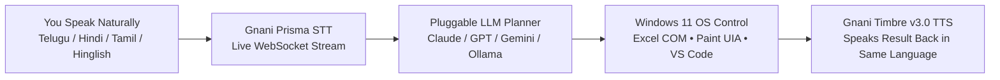

# Raay — Why We Built a Native-Language Voice OS for Windows
**Repo:** [https://github.com/vakrahul/Raay](https://github.com/vakrahul/Raay)  
**Builders:** Rahul Vakiti & Samyutha

---

## Why We Built This
Most people in India don't think in English prompts. If you put a laptop in front of a kirana store owner, our parents, or someone who speaks Telugu, Hindi, or Tamil at home, the biggest wall between them and the computer is the English keyboard.

Even when people try voice assistants or chatbots like ChatGPT and Gemini, two things break immediately:
1. **They are stuck inside a browser tab.** Ask a chatbot to open your Excel grocery sheet and check today's UPI payments, or open MS Paint and draw a diagram, and it replies: *"I'm a text model, I can't access your desktop."*
2. **They fail on how we actually talk.** In real life, nobody speaks textbook Telugu or pure English. We mix them in the same sentence: *"Rahul, grocery Excel file open cheyyi — indulo UPI payments enni?"* or *"Circle lopa unna red color ni yellow ki change cheyyi."*

We built **Raay** so you don't have to type at all. You just talk to your Windows laptop in your own language, and it actually opens the apps and does the work in front of you.

---

## How It Works Under the Hood

1. **Listening (`Gnani Prisma STT` — `wss://api.vachana.ai/stt/v3/stream`):**
   A lightweight background script (`scripts/rahul_background_listener.py`) captures 16 kHz mic audio and streams it over WebSocket to Prisma STT. We tuned the silence window (`280ms`) so as soon as you finish a sentence in Telugu, Hindi, Tamil, or Hinglish, the transcript is ready almost immediately—even with room noise (`nc=true`).
2. **Planning (`Pluggable LLM Adapter` — `src/providers/`):**
   Before running any desktop task, Raay passes open-ended requests through a clean adapter layer. You aren't locked into one LLM: you can plug in **Claude, GPT-4o, Gemini, or a local Ollama model** to break the request into steps before automation runs. Common actions (like Excel math or Paint edits) take a fast local path (`<10ms`) so you don't wait 4 seconds on an API call.
3. **Doing the Work on Windows (`src/windows_integration/`):**
   Instead of fragile screen-coordinate macros that break when a window moves, we hooked directly into **Windows UI Automation (`IUIAutomation`)**, **Win32 window handles (`HWND`)**, and **Microsoft Excel COM**:
   - **Excel Kirana / Grocery Sheet:** Opens the live 25-item sheet in Excel, builds the Bar/Pie charts on screen, and calculates exact UPI, Card, Cash, and GST numbers from the rows.
   - **MS Paint Live Drawing & Editing:** Finds the actual shape and colour buttons on the Paint ribbon, draws the shapes, and remembers what it drew. If you change your mind mid-way (*"change the circle color to yellow"* or *"ఆపు! Undo చెయ్"*), it interrupts in under `200ms`, presses `Ctrl+Z`, picks yellow, and redraws it.
   - **VS Code, Browser & Local Files:** Exports Paint designs into an HTML/SVG project in VS Code, opens websites in Chrome, or scans `~/Downloads` to summarize the latest report into Notepad.
4. **Talking Back (`Gnani Timbre v3.0 TTS` — `POST /api/v1/tts/sse`):**
   Once the task finishes on screen, Timbre (`Shivani` v3.0) speaks the answer back in the same language you used, pronouncing Indian names and rupee amounts (`₹4,741`, `₹2,478`) naturally. We also added a local SHA-256 WAV cache (`.winai/tts_cache`) so frequent replies play back in `<1ms` while automatically muting the mic so the assistant never hears its own voice.

---

## What We Tested Live (Raay vs. Standard Chatbots)

| What We Asked (Spoken Live in Telugu + English) | Standard Chatbot | Raay on Windows 11 |
| :--- | :--- | :--- |
| *"రాహుల్, గ్రోసరీ ఓపెన్ చెయ్ — అందులో యుపిఐ పేమెంట్స్ ఎన్ని?"* | ❌ Can't open Excel or read local files | ✅ Opened Excel + charts, replied: **12 UPI items = ₹2,478** (out of ₹4,741 total, ₹249 GST) |
| *"రాహుల్, పెయింట్ ఓపెన్ చెయ్ — డ్రా సర్కిల్ విత్ కలర్ రెడ్, పక్కనే హార్ట్ సింబల్"* | ❌ Can't launch or draw in Paint | ✅ Opened MS Paint, drew a red circle, and placed a red heart right beside it |
| *"చేంజ్ ద కలర్ ఆఫ్ సర్కిల్ టు ఎల్లో"* | ❌ Can't edit an active canvas | ✅ Undid the red fill and redrew the circle in yellow on the live canvas |
| *"సేమ్ డిజైన్ కాన్సెప్ట్ ని విఎస్ కోడ్ లో సేవ్ చెయ్యి"* | ❌ Text output only | ✅ Wrote the HTML5/SVG + JSON files and opened the project in **VS Code** |
| *"డౌన్‌లోడ్స్ లో లేటెస్ట్ రిపోర్ట్ సమ్మరీ సేవ్ చెయ్యి"* | ❌ Can't read `~/Downloads` | ✅ Found the latest report in `Downloads`, summarized it, and opened **Notepad** |

---

## Who Built What
- **Rahul Vakiti:** Built the Gnani Prisma WebSocket STT & Timbre SSE TTS streaming pipeline, the always-on background mic listener, the Windows 11 UIA/Win32 controllers (MS Paint, Excel COM, VS Code, Browser), the `<200ms` interrupt/undo engine, and Windows DPAPI key encryption.
- **Samyutha:** Built the multilingual conversational planner (`te-IN`, `hi-IN`, `ta-IN`, `hi-en`, `en-IN`), the Indian script verification rules, the 25-item Kirana/Grocery billing & GST analytics dataset, and the live Web UI cockpit.
