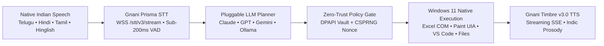

# RAAY — 1-Page Solution Pitch
**Project Title:** Raay — Sovereign Indian Voice Operating System for Windows 11  
**Repository:** [https://github.com/vakrahul/Raay](https://github.com/vakrahul/Raay)  
**Built By:** Rahul Vakiti & Samyutha (`#GreatIndianAIInternshipChallenge` • `#GnaniAI`)

---

## 1. The Problem: The English Typing Barrier & Browser-Trapped AI
Over a billion Indians think and speak fastest in **Telugu, Hindi, Tamil, Kannada, Malayalam, Bengali, or code-mixed Hinglish/Telugish**—yet operating a computer still requires typing complex commands or prompts in English. Meanwhile, standard AI chatbots (`ChatGPT`, `Gemini`, `Claude` web) are trapped inside a browser tab: they can only *talk back in text*, and fail (`0/5`) when asked to control local desktop software, edit live canvases, or audit local spreadsheets.

## 2. Our Solution: Raay (Zero-Typing Sovereign Voice OS)
**Raay** transforms **Gnani.ai's sovereign speech models** into an always-on, hands-free **Windows 11 Voice Operating System**. Users speak naturally in their native Indian language without touching the keyboard or mouse, and Raay autonomously plans, executes, and verifies multi-step workflows across native Windows applications.

## 3. Gnani.ai Models & Pluggable Architecture Used
1. **Gnani Prisma STT (`WSS /stt/v3/stream` & `POST /stt/v3`):** Streams 16 kHz mono PCM16 audio with server-side VAD (`280ms` silence window), telephonic noise cancellation (`nc=true`), domain keyword biasing, and code-mixed speech recognition in under `200ms`.
2. **Pluggable External LLM Task Planner (`src/providers/`):** Connects **Claude, GPT-4o, Gemini Flash/Pro, or local Ollama** via a unified `BaseModelProvider` interface to decompose spoken intents into deterministic Directed Acyclic Graph (DAG) desktop tasks before execution.
3. **Windows 11 Native Execution Engine (`src/windows_integration/`):** Combines the Windows UI Automation (`IUIAutomation`) accessibility tree, Win32 HWND focus guards, Microsoft Excel COM automation, and pixel-verified OpenCV vision.
4. **Gnani Timbre v3.0 & v2.5 TTS (`POST /api/v1/tts/sse`):** Speaks verified results back with natural Indian prosody and authentic `₹` rupee / lakh / crore cadence, accelerated by a `<1ms` SHA-256 disk cache.

## 4. Live Seen Desktop Tasks & Benchmark (`Raay 5/5` vs. `Standard Chatbot 0/5`)

| # | Live Seen Desktop Task | Spoken Native Command | Verified Outcome on Windows 11 |
| :- | :--- | :--- | :--- |
| **1** | **Kirana / Grocery Excel BI & GST Audit** | *"రాహుల్, గ్రోసరీ ఓపెన్ చెయ్ — అందులో యుపిఐ పేమెంట్స్ ఎన్ని?"* | Opens 25-item Excel sheet, renders live COM Bar/Pie Charts, and speaks exact UPI (`₹2,478`), Card (`₹1,323`), Cash (`₹940`) & GST (`₹249`) totals |
| **2** | **MS Paint Multi-Object Studio** | *"రాహుల్, పెయింట్ ఓపెన్ చెయ్ — డ్రా సర్కిల్ విత్ కలర్ రెడ్, పక్కనే హార్ట్ సింబల్"* | Launches MS Paint, inspects UIA ribbon controls, selects shapes/swatches, and draws pixel-verified objects live |
| **3** | **Sub-200ms Live Barge-In & Recolour** | *"చేంజ్ ద కలర్ ఆఫ్ సర్కిల్ టు ఎల్లో!"* / *"ఆపు! Undo చెయ్. Gold colour వాడు"* | Halts active stroke in `<200ms`, releases mouse locks, runs `Ctrl+Z` undo, and recolours the target object in-place |
| **4** | **Cross-App Design-to-Code Export** | *"సేమ్ డిజైన్ కాన్సెప్ట్ ని విఎస్ కోడ్ లో కాపీ చేసి ప్రాజెక్ట్ లో సేవ్ చెయ్యి"* | Exports the active MS Paint scene into an HTML5/SVG + JSON blueprint and opens it live in **VS Code** |
| **5** | **Local Report Discovery & Summary** | *"డౌన్‌లోడ్స్ లో లేటెస్ట్ రిపోర్ట్ ఫైండ్ చేసి సమ్మరీ సేవ్ చెయ్యి"* | Scans `~/Downloads`, summarizes the latest report in Telugu & English, and opens it in **Notepad** |

## 5. Target Users & Real-World Impact
- **Small Business & Kirana Store Owners:** Audit daily Excel GST bills, UPI collections, and low-stock inventory entirely in Telugu, Tamil, or Hindi without knowing Excel formulas or English typing.
- **Students, Creators & Accessibility Users:** Operate design tools, code editors, browsers, and local documents hands-free in their native language.

## 6. Team Contributions
- **Rahul Vakiti:** Systems Architecture, Gnani Prisma STT & Timbre v3.0 Streaming Pipeline, Windows 11 UIA / Excel COM / MS Paint Execution Controllers, Sub-200ms Barge-In Engine, and Windows DPAPI Security Core.
- **Samyutha:** Multilingual Conversational Planner (`te-IN`, `hi-IN`, `ta-IN`, `hi-en`, `en-IN`), Indic Script Ratio Verification, Kirana/Grocery BI Dataset & Analytics Modelling, and 3D Web Cockpit UX.
