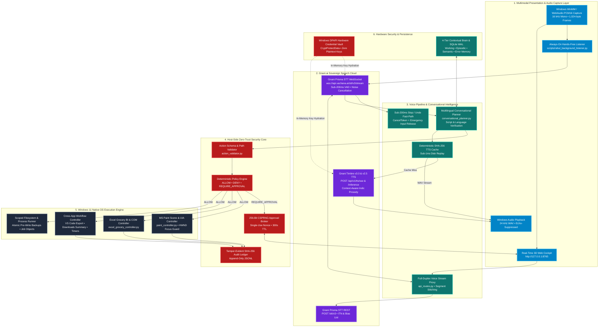
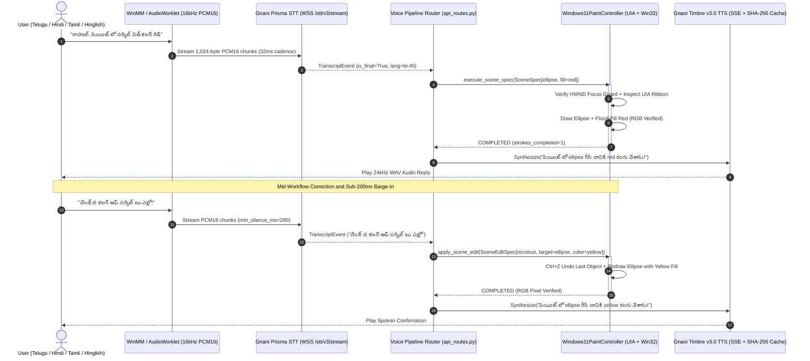
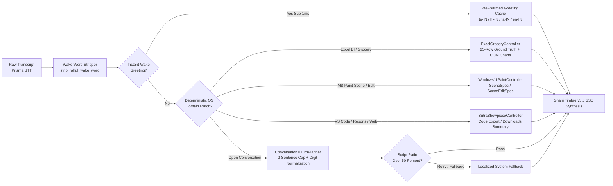
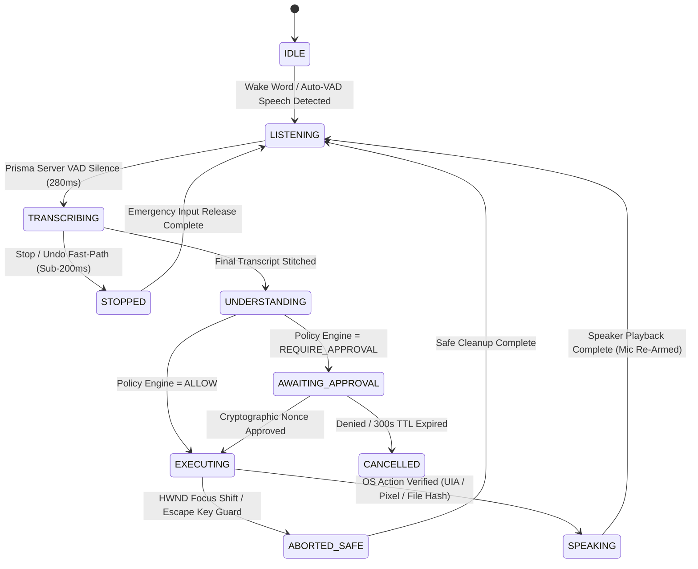

# SYSTEM ARCHITECTURE SPECIFICATION
## Sovereign Indian Voice Operating System (RAY / WinAI-OE)

**Document Version:** 3.0.0  
**Platform:** Windows 10 / 11 (x64) • Python 3.11 / 3.12 • FastAPI • WinMM & WebAudio  
**Speech Stack:** Gnani.ai Sovereign Speech APIs (`Gnani Prisma STT` & `Gnani Timbre TTS`)  
**Security Posture:** Zero Implicit Trust • Windows DPAPI Hardware Vault • SHA-256 Hash-Chained Audit Ledger  

---

## 1. Architectural Vision

Most AI assistants are trapped inside a browser tab and assume the user can type complex prompts in English. **RAY (WinAI-OE)** re-architects human-computer interaction from the ground up as a **Sovereign Indian Voice Operating System** for Windows 11:

1. **Zero-Typing Native Speech Interface:** Listens continuously in **Telugu (`te-IN`)**, **Hindi (`hi-IN`)**, **Tamil (`ta-IN`)**, **Kannada (`kn-IN`)**, **Malayalam (`ml-IN`)**, **Bengali (`bn-IN`)**, **Marathi (`mr-IN`)**, **Gujarati (`gu-IN`)**, **Punjabi (`pa-IN`)**, **Hinglish (`hi-en`)**, and **Indian English (`en-IN`)** via **Gnani Prisma STT** (`WSS /stt/v3/stream`).
2. **Sub-200ms Real-Time Barge-In & Atomic Recovery:** Users can interrupt an active drawing stroke or multi-step workflow mid-flight in their native language (*"ఆపు! Undo చెయ్"* / *"Ruko!"* / *"Nillu!"*), triggering immediate hardware input release and in-place plan correction.
3. **Deterministic Native OS Execution:** Operates real Windows applications (**Microsoft Paint**, **Microsoft Excel COM & BI Charts**, **Visual Studio Code**, **Notepad**, **Chrome**, and **Windows File Explorer**) using the Windows UI Automation (`IUIAutomation`) accessibility tree, Win32 HWND focus guards, and pixel-verified computer vision.
4. **Out-of-Band Zero-Trust Security Core:** Generative models have zero direct execution authority. Every proposed tool call traverses a deterministic host-side policy engine, Pydantic schema validator, and 256-bit CSPRNG human-in-the-loop approval broker.

---

## 2. End-to-End System Architecture (Mermaid)

---

## 3. Real-Time Streaming, Barge-In & Atomic Undo Sequence

A core engineering requirement of a voice operating system is **instant interruptibility**. When the user speaks a stop or correction phrase mid-execution (*"ఆపు! Undo చెయ్. Gold colour వాడు"* / *"Change the color of the circle to yellow"*), the system halts physical mouse/keyboard actions in under `200ms`, releases all OS input locks, and mutates the active `SceneSpec` in place.

---

## 4. Conversational Planner & Multilingual Script Verification

Located in `src/voice/conversational_planner.py`, the planner enforces strict language and script alignment across 5 primary reply locales (`te-IN`, `hi-IN`, `hi-en`, `ta-IN`, `en-IN`) with bounded 3-turn memory (`240` tokens max):

---

## 5. Multi-Application Execution State Machine

---

## 6. Subsystem Specifications

### 6.1 Gnani.ai Sovereign Speech Integration (`src/voice/`)
- **Speech-to-Text (`gnani_stt.py`):**
  - **Realtime WebSocket (`wss://api.vachana.ai/stt/v3/stream`):** Streams 16-bit 16 kHz mono PCM frames (`1,024` bytes = `32ms` per frame) with configurable server VAD headers (`x-vad-threshold`, `x-min-silence-ms`, `x-min-speech-ms`, `x-min-segment-ms`), keyword biasing (`x-bias-list`, `x-bias-score`), and dynamic runtime reconfiguration via `update_settings` frames.
  - **REST Batch / File Decode (`POST https://api.vachana.ai/stt/v3`):** Supports multipart audio uploads with noise cancellation (`nc=true`), Inverse Text Normalization (`format=transcribe` for `hi-IN` and `en-IN`), and circuit-breaker resilience.
- **Text-to-Speech (`gnani_tts.py`):**
  - **SSE Streaming (`POST https://api.vachana.ai/api/v1/tts/sse`) & REST (`POST /api/v1/tts/inference`):** Strict catalog validation across **`timbre-v3.0`** (13 multilingual voices speaking 10 Indic languages) and **`timbre-v2.5`** (42 voices).
  - **RIFF Header Repair & SHA-256 Disk Cache:** Automatically repairs `0xFFFFFFFF` streaming WAV header sentinels and caches synthesized utterances by `sha256(text + voice + model)` in `.winai/tts_cache/` for `<1ms` repeat playback.

### 6.2 Windows 11 Native OS Controllers (`src/windows_integration/`)
- **`Windows11PaintController` (`paint_controller.py`):**
  - Discovers MS Paint canvas bounds, tools, shapes, and colour swatches dynamically via the Windows UI Automation (`IUIAutomation`) tree with zero brittle hardcoded coordinates.
  - Enforces a per-stroke **HWND & PID Foreground Guard** (`verify_foreground_guard`) and registers an `atexit` / signal **Emergency Input Release** handler that unconditionally releases mouse buttons and modifier keys (`LBUTTON`, `CTRL`, `SHIFT`, `ALT`).
  - Supports structured `SceneSpec` drawing (including a 20-object Starry Night Futuristic City skyline) and in-place `SceneEditSpec` mutations (`recolour`, `resize`, `move`, `add`, `remove`).
- **`ExcelGroceryController` (`excel_grocery_controller.py`):**
  - Manages a 25-item Indian grocery billing dataset with exact Python ground-truth analytics (Subtotal, item-wise GST, UPI vs. Card vs. Cash breakdown, category totals, and low-stock alerts).
  - Launches Microsoft Excel (`XLMAIN`) via COM automation to render native Excel bar and pie charts live on screen and answers multilingual voice queries in `<10ms`.
- **`SutraShowpieceWorkflowController` (`sutra_showpiece_workflows.py`):**
  - **Cross-App Design-to-Code:** Exports active MS Paint `SceneSpec` scenes into responsive HTML5/SVG + JSON blueprints and opens them directly in **Visual Studio Code**.
  - **Autonomous Local Report Summarizer:** Scans `~/Downloads` for the latest `.pdf` / `.md` / `.txt` report, extracts key findings into a bilingual executive summary, and opens it in **Notepad**.
  - **Ambient Audio & OS Reminders:** Synthesizes warm harmonic ambient audio streams and persists verified desktop reminders (`workspace/reminders/active_reminders.json`).

### 6.3 Security, Privacy & Credential Hygiene (`src/security/`, `src/storage/`)
- **Windows DPAPI Hardware Credential Vault (`credential_vault.py`):** Encrypts all API keys using `CryptProtectData` bound to the local Windows user login and TPM. **Zero API keys or secrets are ever stored in plaintext or committed to Git.**
- **Sanitized Error & Log Redaction (`audit_logger.py`, `base.py`):** Automatically scrubs headers, bearer tokens, and `x-api-key-id` values from all exceptions, logs, and UI responses.
- **Tamper-Evident Audit Chain:** Every tool execution and policy decision is appended to a SHA-256 hash-chained JSONL ledger.
